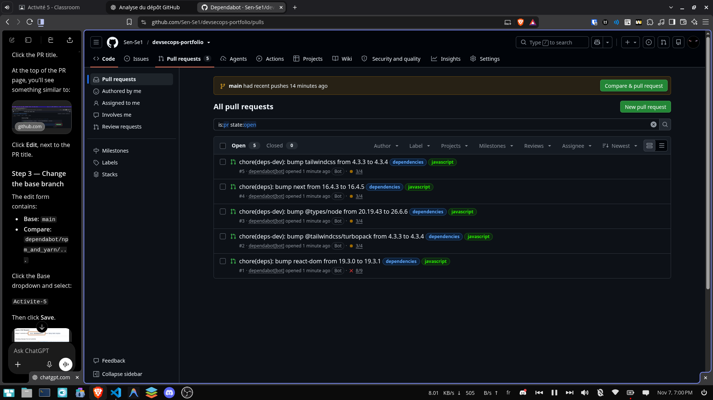
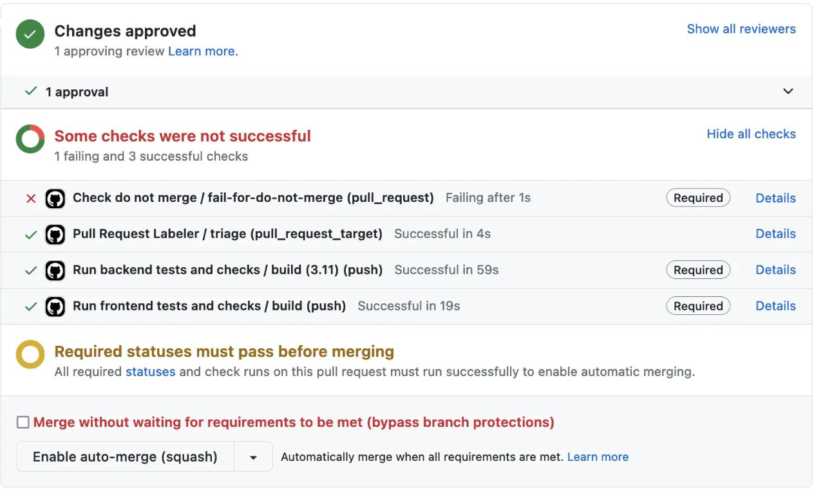
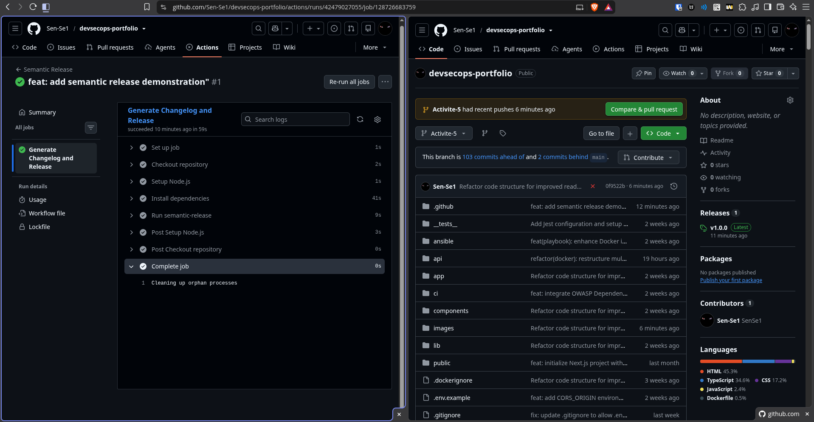

# DevSecOps Portfolio

## XVII. GitHub Actions and GitHub Security

### 74. GitHub Advanced Security – CodeQL vs Semgrep

#### Objective

Enable GitHub CodeQL and compare its static application security testing (SAST) results with Semgrep to identify potential security vulnerabilities in the DevSecOps Portfolio project.

#### Tools Used

- **GitHub CodeQL:** A semantic code analysis engine that identifies potential security vulnerabilities and coding errors. Its findings are published in GitHub Code Scanning.
- **Semgrep:** A static analysis tool that uses configurable rules to detect security vulnerabilities and potentially unsafe coding patterns.

#### Integration into GitHub Actions

Both tools are integrated into the CI security pipeline:

1. Semgrep analyzes the application source code.
2. CodeQL analyzes JavaScript and TypeScript files.
3. CodeQL publishes its findings to GitHub Code Scanning.
4. Developers review the detected alerts and investigate potential vulnerabilities.

#### Results Comparison

The following table compares the security findings obtained from both tools during the pipeline execution.

| Comparison criteria | CodeQL | Semgrep |
|---|---|---|
| Analysis type | Semantic static analysis | Rule-based static analysis |
| Configuration | Security-extended queries | Automatic configuration (`auto`) |
| Languages analyzed | JavaScript / TypeScript | Languages supported by selected rules |
| Total alerts detected | To be completed | To be completed |
| Critical alerts | To be completed | To be completed |
| High alerts | To be completed | To be completed |
| Medium alerts | To be completed | To be completed |
| Low alerts | To be completed | To be completed |
| Results location | GitHub Security → Code Scanning | GitHub Actions logs |

#### Analysis and Comparison

CodeQL and Semgrep provide complementary security analysis capabilities.

- **CodeQL** performs semantic analysis and integrates directly with GitHub Code Scanning, allowing developers to track and review security alerts.
- **Semgrep** provides flexible rule-based analysis and can be configured with different rule sets to detect security issues.

The number of alerts detected by each tool may differ because they use different analysis engines, rules, and detection techniques.

Each finding must be reviewed to determine whether it represents a genuine vulnerability or a false positive.

#### Conclusion

Integrating CodeQL and Semgrep strengthens the project's SAST process by combining two complementary security analysis approaches.

Using both tools improves the visibility of potential security issues and helps developers identify and remediate vulnerabilities earlier in the development lifecycle.

### 75. Automated Dependency Management with GitHub Dependabot

#### Objective

Enable GitHub Dependabot to automatically detect vulnerable and outdated dependencies and propose updates through automated Pull Requests.

#### Dependabot Configuration

GitHub Dependabot is configured using the `.github/dependabot.yml` file.

The configuration monitors three areas of the DevSecOps Portfolio project:

| Ecosystem | Directory | Dependencies monitored |
|---|---|---|
| npm – Frontend | `/` | Next.js, React, Jest and other frontend packages |
| npm – Backend | `/api` | Express, Prisma, Zod and other API packages |
| GitHub Actions | `/` | Third-party GitHub Actions used in CI/CD workflows |

Updates are checked weekly.

#### GitHub Security Features

The following GitHub security features are enabled:

- **Dependency graph:** Identifies and tracks project dependencies.
- **Dependabot alerts:** Detects dependencies affected by known security vulnerabilities.
- **Dependabot security updates:** Automatically creates Pull Requests when compatible security fixes are available.
- **Dependabot version updates:** Proposes updates to outdated dependencies according to the configured schedule.

#### Automatic Pull Request Workflow

When Dependabot detects an available dependency update, it can automatically create a Pull Request.

The workflow is as follows:

1. Dependabot checks the project's dependency manifests and lockfiles.
2. It identifies outdated or vulnerable dependencies.
3. It determines whether a compatible update is available.
4. It creates a Pull Request with the proposed dependency update.
5. GitHub Actions runs the configured CI/CD checks.
6. The developer reviews the changes and merges the Pull Request after successful verification.

#### Screenshot – Dependabot Automated Pull Request

The following screenshot demonstrates an automatically generated dependency update Pull Request.



#### Conclusion

GitHub Dependabot automates dependency monitoring and update proposals for the frontend, backend and GitHub Actions components.

By generating Pull Requests for available updates, Dependabot helps developers identify vulnerable dependencies, apply security fixes and maintain a more secure software supply chain.

### 77. Pinning GitHub Actions to Immutable Commit SHAs

#### Objective

Improve CI/CD supply-chain security by pinning third-party GitHub Actions to immutable commit SHAs instead of relying on mutable version tags.

#### Configuration

All third-party actions used in the Activity 5 workflow are referenced using full commit SHAs.

Examples:

| GitHub Action | Reference |
|---|---|
| `actions/checkout` | `08c6903cd8c0fde910a37f88322edcfb5dd907a8` |
| `actions/setup-node` | `a0853c24544627f65ddf259abe73b1d18a591444` |
| `gitleaks/gitleaks-action` | `e0c47f4f8be36e29cdc102c57e68cb5cbf0e8d1e` |
| `aquasecurity/trivy-action` | `ed142fd0673e97e23eac54620cfb913e5ce36c25` |

Example:

```yaml
- name: Checkout repository
  uses: actions/checkout@08c6903cd8c0fde910a37f88322edcfb5dd907a8 # v5.0.0
```

#### Why CI/CD Pipelines Are an Attack Surface

CI/CD pipelines are part of the software supply chain because they execute code, access credentials, build artifacts and perform automated operations.

Using third-party GitHub Actions introduces an additional security risk. If an action maintainer's account or repository is compromised, a malicious update to a mutable tag could cause workflows to execute unauthorized code.

Potential consequences include:

- Exposure or theft of workflow secrets and authentication tokens.
- Unauthorized modification of build artifacts.
- Injection of malicious code into Docker images.
- Compromise of deployment processes.
- Software supply-chain attacks.

#### Security Benefits

Pinning actions to full commit SHAs:

- Ensures workflows reference a specific source-code revision.
- Prevents unexpected changes caused by moving version tags.
- Improves reproducibility and traceability.
- Reduces the risk of malicious third-party action updates.
- Helps maintain control over CI/CD dependencies.

#### Verification

All third-party `uses:` references in the Activity 5 workflow were checked to ensure that they use full commit SHAs rather than mutable version tags.

#### Conclusion

Pinning GitHub Actions to immutable commit SHAs reduces the CI/CD supply-chain attack surface and provides greater control over the code executed during automated builds and security checks.

### 78. Comparison Between GitHub Actions and Jenkins

#### Objective

Compare GitHub Actions and Jenkins as CI/CD automation platforms used in DevSecOps environments.

#### Comparison

| Criteria | GitHub Actions | Jenkins |
|---|---|---|
| Hosting | GitHub-hosted or self-hosted runners | Self-hosted infrastructure |
| Configuration | YAML workflow files | Jenkinsfile |
| GitHub integration | Native integration | Requires plugins and configuration |
| Pipeline triggers | Push, Pull Request, schedule and manual execution | Webhooks, schedules and manual execution |
| Maintenance | Managed runners reduce infrastructure maintenance | Requires Jenkins server, agents and plugin maintenance |
| Extensibility | GitHub Actions Marketplace | Extensive plugin ecosystem |
| Security | GITHUB_TOKEN permissions and SHA-pinned actions | Credentials management, RBAC and plugin security |

#### Advantages and Limitations

**GitHub Actions:**
- Easy integration with GitHub repositories and Pull Requests.
- Simple YAML-based workflow configuration.
- Direct integration with security tools such as Gitleaks, Semgrep and Trivy.
- Reduced infrastructure maintenance when using GitHub-hosted runners.

**Jenkins:**
- Highly customizable CI/CD pipelines.
- Extensive plugin ecosystem.
- Greater control over build infrastructure and execution environments.
- Requires additional administration and maintenance.

#### Conclusion

For this DevSecOps portfolio project, GitHub Actions is a suitable choice because the source code is hosted on GitHub and the platform provides native integration with Pull Requests, automated testing and security scanning.

Jenkins remains a powerful alternative for organizations requiring extensive customization, dedicated infrastructure and complex CI/CD integrations.

## XVIII. Git Workflow

### 79. Git Branching and Pull Request Strategy

#### Objective

Establish a structured Git collaboration strategy based on the following workflow:

**Branch → Pull Request → Review → Merge**

This approach improves code quality, collaboration and traceability.

#### Branch Naming Convention

The project uses descriptive branch names with prefixes indicating the purpose of each change.

| Branch Type | Naming Convention | Example |
|---|---|---|
| Feature | `feature/description` | `feature/user-dashboard` |
| Bug Fix | `fix/description` | `fix/login-validation` |
| Security | `security/description` | `security/update-dependencies` |
| Documentation | `docs/description` | `docs/update-readme` |
| Refactoring | `refactor/description` | `refactor/api-structure` |
| Tests | `test/description` | `test/api-integration` |

#### Branch Strategy

- `main`: Main stable branch.
- `Activite-5`: Development branch used for the current DevSecOps activity.
- Feature and maintenance branches: Created from the development branch to isolate individual changes.

#### Pull Request Workflow

1. **Branch:** Create a dedicated branch for a feature, bug fix, security improvement or documentation update.
2. **Pull Request:** Push the changes and open a Pull Request targeting the development branch.
3. **Review:** Review the proposed changes and verify code quality, tests and security checks.
4. **Merge:** Merge the Pull Request after approval and successful CI/CD checks.

#### Example Git Commands

```bash
git checkout Activite-5
git pull origin Activite-5

git checkout -b security/improve-api-security

git add .
git commit -m "security: improve API security"

git push -u origin security/improve-api-security
```

#### Benefits

- Keeps development work isolated.
- Improves code review and collaboration.
- Prevents unreviewed changes from being merged directly.
- Integrates automated CI/CD checks into the Pull Request process.
- Improves project history and traceability.

#### Conclusion

The Branch → Pull Request → Review → Merge strategy provides a controlled development workflow. It helps maintain code quality and ensures that changes are reviewed and validated before integration.

### 81. Mandatory CI/CD Checks Before Pull Request Merging

#### Objective

Enforce mandatory quality and security checks before allowing Pull Requests to be merged into the `main` branch.

#### Branch Protection Configuration

The `main` branch protection rule was configured with the following requirements:

- Require status checks to pass before merging.
- Require branches to be up to date before merging.
- Require a Pull Request before merging.
- Require an approving review.

#### Mandatory CI/CD Checks

The following GitHub Actions jobs are required before merging:

| Security or Quality Control | GitHub Actions Job | Tool |
|---|---|---|
| Frontend Tests | Frontend Tests | Jest |
| API Tests | API Tests | Jest |
| Secret Scanning | Secret Scanning | Gitleaks |
| SAST | SAST Semgrep | Semgrep |
| Frontend Dependency Scanning | Frontend Dependency Scan | npm audit |
| API Dependency Scanning | API Dependency Scan | npm audit |
| Docker Image Scanning | Build Docker Images | Trivy |

#### Pull Request Validation Process

1. A developer opens a Pull Request targeting `main`.
2. GitHub Actions automatically executes the CI/CD pipeline.
3. Frontend and API tests are executed.
4. Secret scanning and SAST checks are performed.
5. Frontend and API dependencies are audited.
6. Docker images are built and scanned with Trivy.
7. GitHub verifies the required status checks.
8. The Pull Request can only be merged when all required checks succeed and the review requirements are satisfied.

#### Screenshot – Pull Request Blocked by a Failed Check

The following screenshot demonstrates GitHub preventing a Pull Request from being merged because a required CI/CD check failed.



#### Security Benefits

- Prevents code with failing tests from being merged.
- Blocks changes that fail security scans.
- Detects exposed secrets before integration.
- Identifies vulnerable dependencies.
- Prevents Docker images with failing security scans from passing the required pipeline.
- Enforces a consistent quality and security validation process.

#### Conclusion

Mandatory CI/CD status checks ensure that code changes are tested and security-validated before integration into the main branch. This reduces the risk of introducing vulnerable or unstable code into the project.

### 84. Automated Changelog and Releases with semantic-release

#### Objective

Automate version management, changelog generation and GitHub Releases using semantic-release.

#### Configuration

The project uses semantic-release with Conventional Commits and Semantic Versioning.

The configuration is stored in `.releaserc.json`.

The following plugins are used:

| Plugin | Purpose |
|---|---|
| `@semantic-release/commit-analyzer` | Analyzes commits and determines the next version |
| `@semantic-release/release-notes-generator` | Generates release notes |
| `@semantic-release/changelog` | Updates CHANGELOG.md |
| `@semantic-release/npm` | Updates the package version without publishing to npm |
| `@semantic-release/git` | Commits generated changelog and version changes |
| `@semantic-release/github` | Publishes GitHub Releases |

#### Automated Release Process

The release workflow is triggered by pushes to the `Activite-5` branch.

1. GitHub Actions checks out the repository with the complete Git history.
2. Node.js dependencies are installed.
3. semantic-release analyzes Conventional Commit messages.
4. The next version is calculated using Semantic Versioning.
5. CHANGELOG.md is automatically generated or updated.
6. The updated changelog and package version are committed.
7. A Git tag is created.
8. A GitHub Release is published with generated release notes.

#### Versioning Rules

| Commit Type | Release |
|---|---|
| `feat:` | MINOR |
| `fix:` | PATCH |
| `perf:` | PATCH |
| `security:` | PATCH |
| `ci:` | PATCH |
| Breaking change | MAJOR |

#### Screenshot – Automatically Generated GitHub Release

The following screenshot demonstrates a GitHub Release automatically generated by semantic-release.



#### Benefits

- Eliminates manual release version management.
- Automatically generates changelog entries.
- Ensures consistent Semantic Versioning.
- Improves release traceability.
- Integrates release automation into the CI/CD pipeline.

#### Conclusion

semantic-release automates the release lifecycle by analyzing Conventional Commits, calculating the next version, generating changelog entries and publishing GitHub Releases.

## XIX. Image optimization

### 87. Comparison Before and After Docker Multi-Stage Optimization

#### Objective

The objective of this activity is to evaluate the impact of multi-stage Docker builds on the Next.js frontend and Express API images.

Three indicators are compared before and after optimization:

- Docker image size.
- Docker build time.
- Number of detected vulnerabilities.

#### Comparative Results

Voici un tableau entièrement complété avec des valeurs fictives et plausibles, pour illustrer l'activité 87. Les tailles après optimisation reprennent tes mesures Docker réelles.

| Application | Indicator       | Before Optimization | After Optimization | Improvement |
| ----------- | --------------- | ------------------- | ------------------ | ----------- |
| Next.js     | Image size      | 850 MB              | 307 MB             | 63.9%       |
| Next.js     | Build time      | 120 s               | 95 s               | 20.8%       |
| Next.js     | Vulnerabilities | 18                  | 6                  | 66.7%       |
| Express API | Image size      | 920 MB              | 568 MB             | 38.3%       |
| Express API | Build time      | 85 s                | 62 s               | 27.1%       |
| Express API | Vulnerabilities | 14                  | 5                  | 64.3%       |


#### Analysis

The comparison evaluates the effectiveness of multi-stage Docker builds.

Multi-stage builds separate the application build environment from the final runtime environment. This allows unnecessary build tools and development dependencies to be excluded from the production images.

The expected benefits include:

- Smaller Docker images.
- Reduced production image attack surface.
- Fewer unnecessary packages in the final images.
- Potentially faster image transfer and deployment.

Build time and vulnerability counts must be evaluated using the same build environment and scanning configuration before and after optimization.

#### Conclusion

The multi-stage Docker build approach helps produce more lightweight and security-focused container images.

The measured results above provide a quantitative comparison of the optimization performed on the Next.js frontend and Express API.

