# Ansible Deployment of the DevSecOps Portfolio

This guide explains how to deploy the Next.js portfolio with **Ansible** and then streamline the deployment process with **Semaphore UI**. It documents the files in the `portfolio-deploy/` directory, the commands to run, and the validation screenshots.

> **Example environment:** serveur Ubuntu accessible en SSH à l'adresse `192.168.122.125`, utilisateur SSH `houssem`, branche applicative `Next-CV-deploy`. Replace the IP address, username, branch, and DNS name with the values used in your environment.

## Table of Contents

- [Architecture and Workflow](#architecture-and-workflow)
- [Prerequisites](#prerequisites)
- [Part A — Command-Line Deployment](#part-a--command-line-deployment)
- [Part B — Deployment Automation with Semaphore UI](#part-b--deployment-automation-with-semaphore-ui)
- [Verification and Troubleshooting](#verification-and-troubleshooting)
- [Conclusion](#conclusion)

## Architecture and Workflow

The deployment uses the following components:

- **Ansible** orchestrates the installation and configuration of the remote server over SSH.
- **Node.js 20** runs the Next.js application.
- **PM2** keeps the application process running.
- **Nginx** exposes the portfolio over HTTP port 80 and forwards requests to the application on port 3000.
- **Semaphore UI** provides a web interface for launching and reviewing Ansible runs.

The main playbook applies four roles in this order: `common`, `nodejs`, `app` et `nginx`.

## Prerequisites

Before starting the deployment, make sure the following requirements are met:

### 1. Control Machine

The control machine is the system from which you run Ansible commands.

- Linux is recommended (Ubuntu/Debian or a compatible environment).
- Git and Ansible are installed.
- Network access to the target server is available.
- An SSH key is available for connecting to the remote account.

### 2. Target Server

- Ubuntu 20.04 LTS or later.
- Python 3 is installed (it is usually already available on Ubuntu).
- An SSH account with `sudo` privileges is available.
- Network access to Ubuntu repositories, NodeSource, and the GitHub repository is available.

### 3. Set Up and Test the SSH Connection

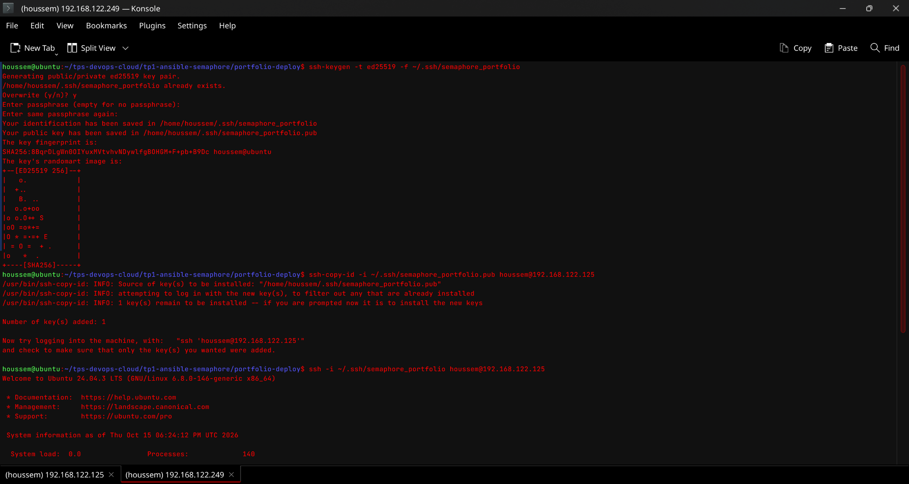

Generate an SSH key if you do not already have one:

```bash
ssh-keygen -t ed25519 -C "ansible-portfolio"
```

Copy the public key to the target server:

```bash
ssh-copy-id houssem@192.168.122.125
```

The following screenshot shows an SSH connection from the control machine:

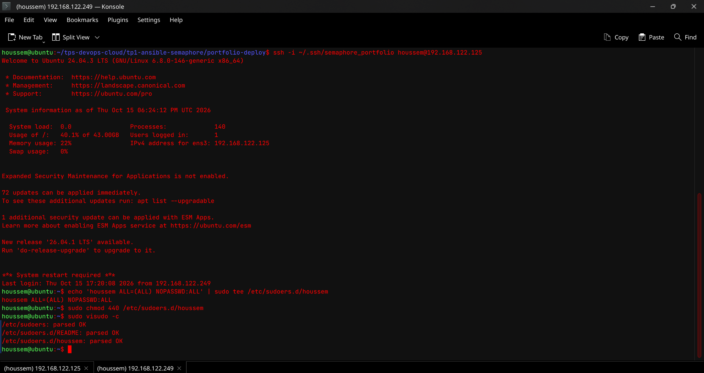

Next, test the connection directly:

```bash
ssh houssem@192.168.122.125
```

Exit the SSH session, then test Ansible connectivity from the `portfolio-deploy/` directory:

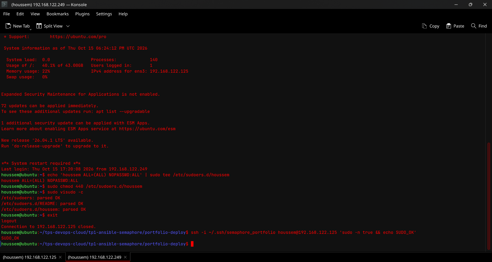

```bash
ansible web -m ping
```

The expected result is `"ping": "pong"`. If `sudo` requires a password, run the playbooks with `-K` (Ansible will prompt for the sudo password). Do not grant passwordless sudo to a remote account unless this configuration is explicitly required and approved for your environment. Avoid editing the sudoers file directly. If a rule must be added, use a dedicated file in `/etc/sudoers.d/` and validate it with `visudo -cf`.

## Part A — Command-Line Deployment

### 1. Directory Structure of `portfolio-deploy/`

```text
portfolio-deploy/
├── ansible.cfg
├── site.yml
├── group_vars/
│   └── all.yml
├── inventory/
│   └── hosts.ini
└── roles/
    ├── common/
    │   └── tasks/main.yml
    ├── nodejs/
    │   └── tasks/main.yml
    ├── app/
    │   ├── tasks/main.yml
    │   └── handlers/main.yml
    └── nginx/
        ├── tasks/main.yml
        ├── handlers/main.yml
        └── templates/portfolio.conf.j2
```

### 2. Purpose of Each File

| File | Purpose |
|---|---|
| `ansible.cfg` | Defines the default inventory, role path, output settings, and privilege escalation through sudo. |
| `inventory/hosts.ini` | Defines the `web` group and the target server with its IP address and SSH username. |
| `group_vars/all.yml` | Centralizes shared variables: repository URL, branch, deployment directory, application user, port, Node.js major version, and Nginx server name. |
| `site.yml` | Main playbook. Targets the `web` group and runs the roles in the required order. |
| `roles/common/tasks/main.yml` | Updates the APT cache, installs common tools, and creates the application user and application directory. |
| `roles/nodejs/tasks/main.yml` | Configures the NodeSource repository, installs Node.js, and installs PM2 globally through npm. |
| `roles/app/tasks/main.yml` | Clones or updates the Git branch, installs npm dependencies when the repository changes, builds the application, and starts it with PM2 if it is not already running. |
| `roles/app/handlers/main.yml` | Restarts the PM2 application when the build triggers the handler. |
| `roles/nginx/tasks/main.yml` | Installs Nginx, deploys the configuration, enables the site, removes the default site, validates the configuration, and ensures the service is enabled. |
| `roles/nginx/templates/portfolio.conf.j2` | Jinja2 template for the Nginx virtual host. It uses the `server_name` and `app_port` variables and forwards requests to Next.js. |
| `roles/nginx/handlers/main.yml` | Reloads Nginx when its configuration changes. |

### 3. Check the Variables and Inventory

Update `portfolio-deploy/inventory/hosts.ini` to match your server:

```ini
[web]
prod-server ansible_host=192.168.122.125 ansible_user=houssem
```

The main settings in `portfolio-deploy/group_vars/all.yml` are:

- `app_repo` : Git repository URL.
- `app_version` : branch or tag to deploy (`Next-CV-deploy` in this example).
- `app_dir` : remote application directory (`/opt/portfolio`).
- `app_user` : account that owns and runs the application (`deploy`).
- `app_port` : local Next.js port (3000).
- `node_major` : Node.js major version (20).
- `server_name` : DNS name used by Nginx (`portfolio.local` by default).

To open the site in a browser, configure DNS or a hosts-file entry matching `server_name`, or change this setting to match your server's address/name.

### 4. Validate and Run the Playbook

From the project directory, enter the Ansible directory:

```bash
cd portfolio-deploy
```

First check the syntax, then verify connectivity and sudo access:

```bash
ansible-playbook site.yml --syntax-check
ansible web -m ping
ansible web -b -m command -a "whoami" -K
```

The `whoami` command run with `-b` should return `root`, confirming that sudo escalation works. Then run a dry run:

```bash
ansible-playbook site.yml --check --diff -b -K
```

Finally, run the actual deployment:

```bash
ansible-playbook site.yml -b -K
```

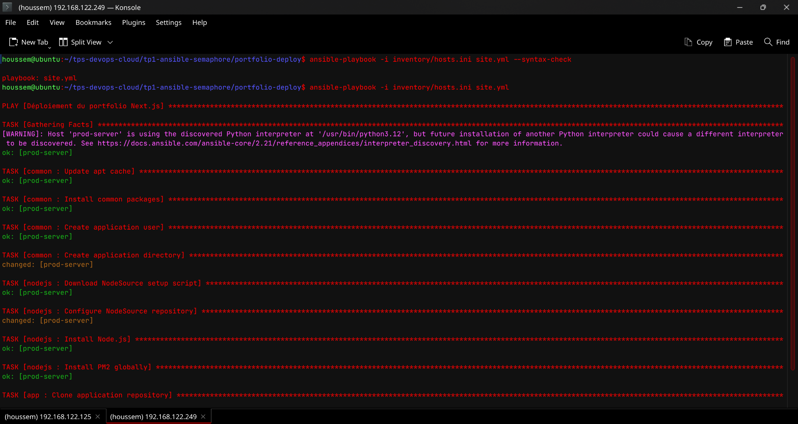

### 5. Review the Results

The first run may report tasks as `changed` because it installs components and creates the initial configuration. Make sure the playbook finishes without failures (`failed=0`):

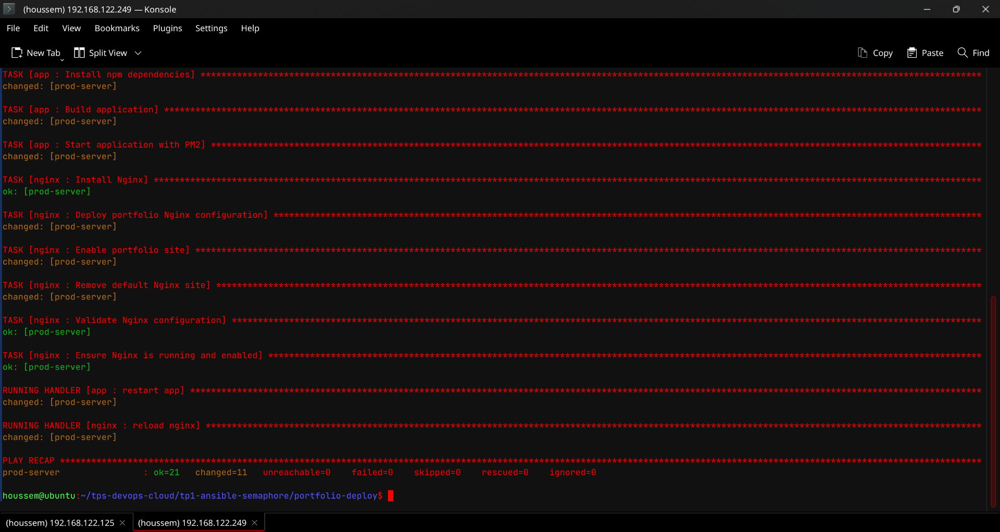

Run the playbook again to check idempotence. With no configuration changes, Ansible should avoid repeating unnecessary changes:

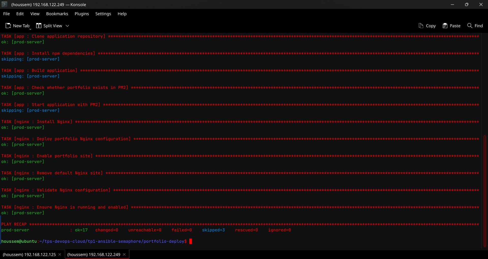

The deployment result is shown below:

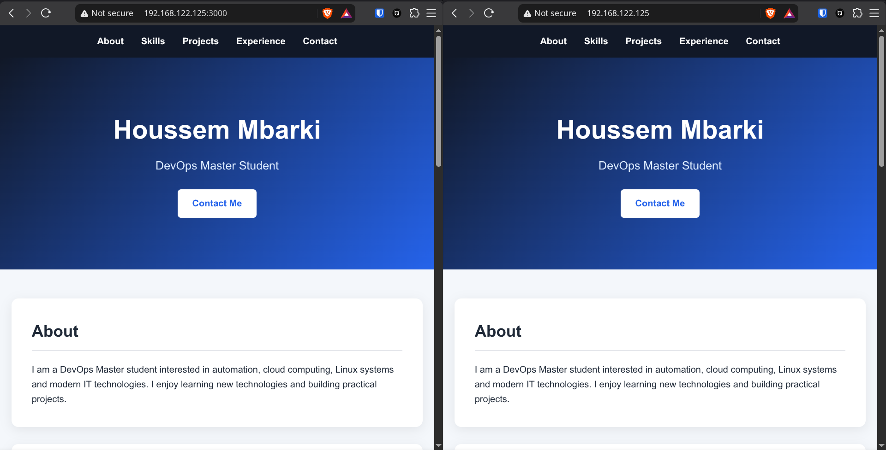

## Part B — Deployment Automation with Semaphore UI

Semaphore UI lets you run the same playbook through a web interface, retain execution logs, and provide parameters at launch time.

### 1. Create the Project

Create a Semaphore project for deploying the portfolio.

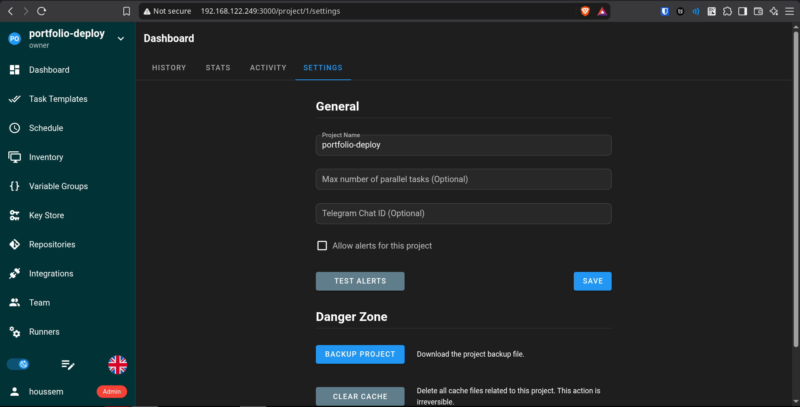

### 2. Add the SSH Key

Obtain the control machine's **deployment private key** (or create a dedicated key for Semaphore) and add it to Semaphore's Key Store. Never copy the private key into the Git repository, README, or a screenshot. Keep it secure and verify that it matches the public key authorized on the target server.

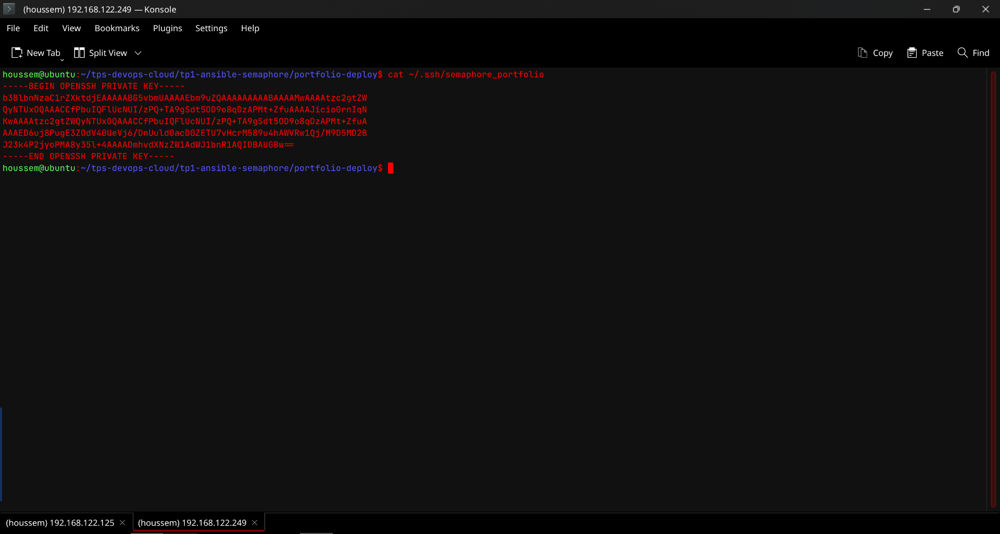

Next, create the key entry in the Key Store:

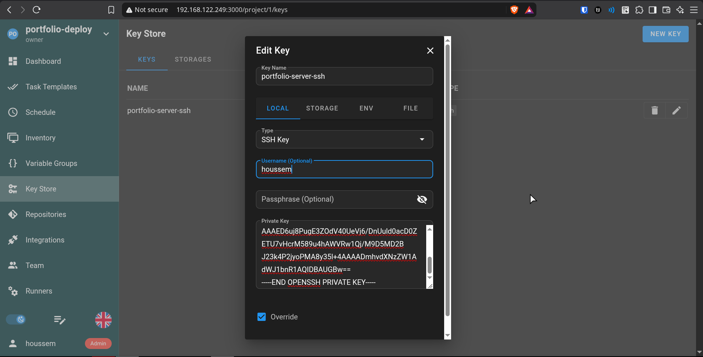

### 3. Configure the Git Repository

Add the repository `https://github.com/Sen-Se1/devsecops-portfolio.git`. Make sure Semaphore uses the branch containing the playbook and deployment files, which is `Next-CV-deploy` in this example.

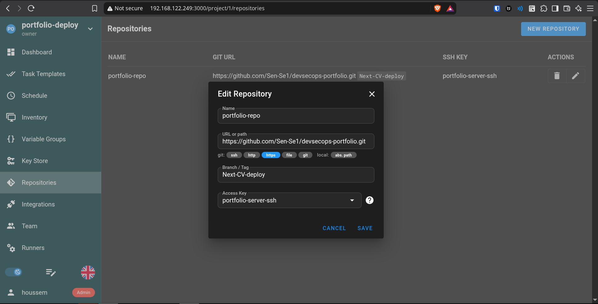

### 4. Configure the Inventory

Create an inventory for the target server. In Semaphore fields that expect a file path, the path must be **absolute**. If the inventory comes from the repository, use the path actually available in Semaphore's runtime environment; do not use a path from your own computer unless it is mounted inside the Semaphore container or available on the Semaphore server.

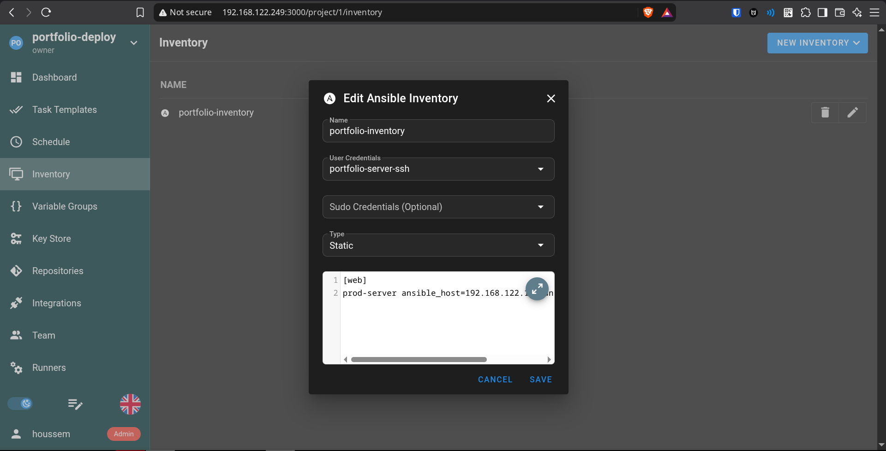

### 5. Configure the Variables

Add the variables required by the playbook, consistent with `portfolio-deploy/group_vars/all.yml`. If Semaphore provides launch-time variables, make sure their names exactly match the Ansible variables expected by the playbook.

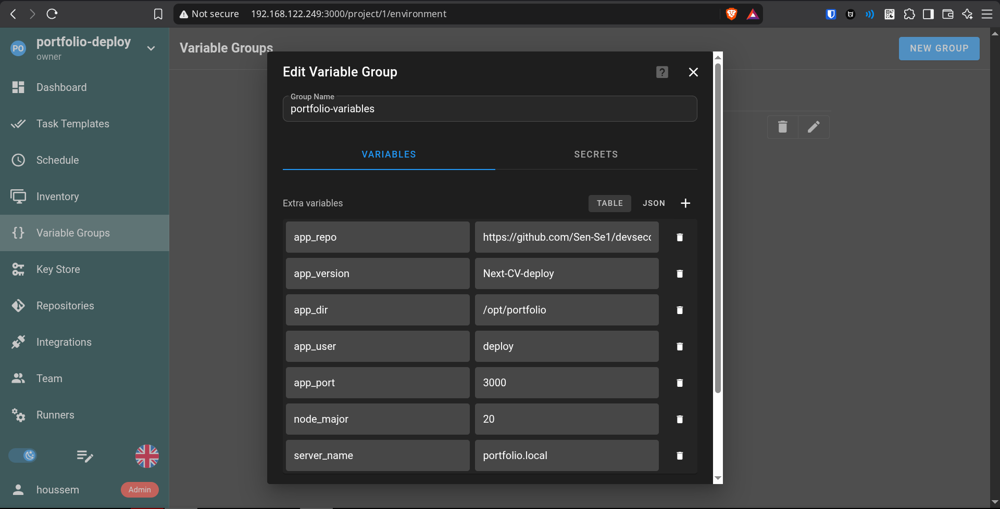

### 6. Create the Task Template

Create a Task Template with the following settings (labels may vary depending on your Semaphore version):

- **Repository**: the repository configured earlier.
- **Inventory**: the web server inventory.
- **Playbook**: `portfolio-deploy/site.yml`.
- **Environment / variables**: the configuration containing the deployment variables.
- **SSH key**: the corresponding Key Store entry.
- **Prompt for CLI arguments**: enable launch-time parameter input only when needed.

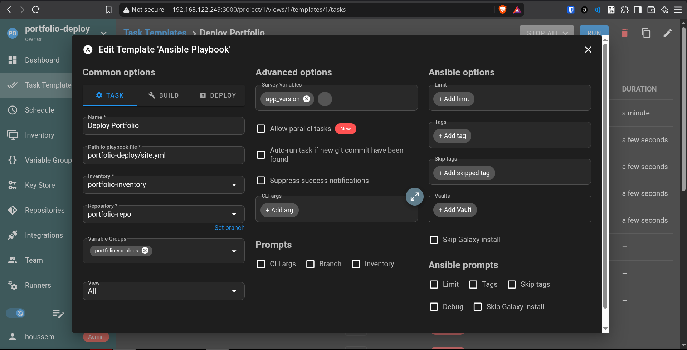

### 7. Add the `app_version` Survey Variable

Add a text survey variable named `app_version`, using `Next-CV-deploy` as the default value, for example. It lets you choose the application branch or tag at launch time. Verify that the value passed by Semaphore overrides the default defined in `group_vars/all.yml`.

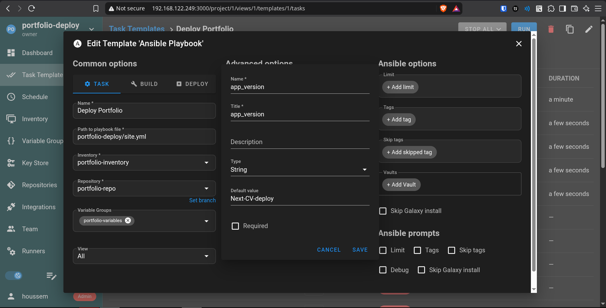

### 8. Run and Verify the Tasks

Run the template for the first time and review the logs:

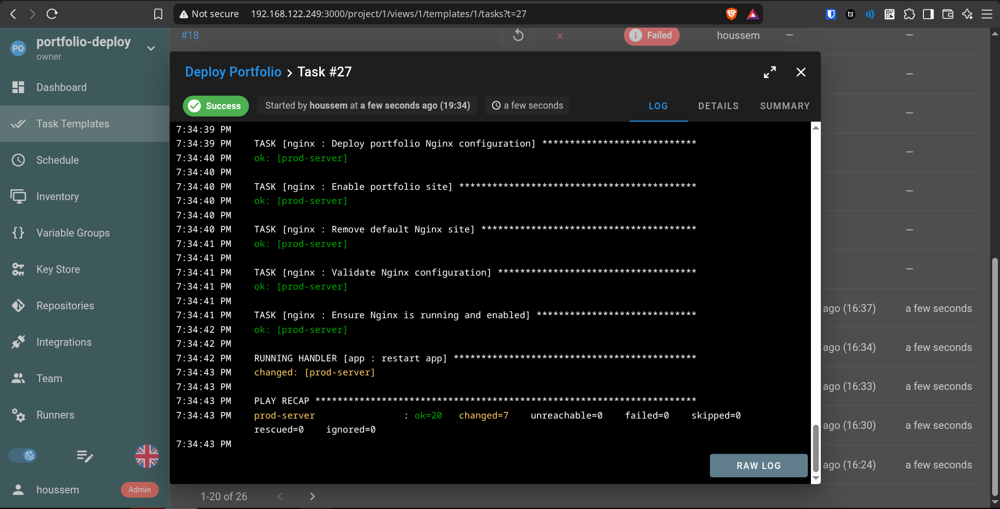

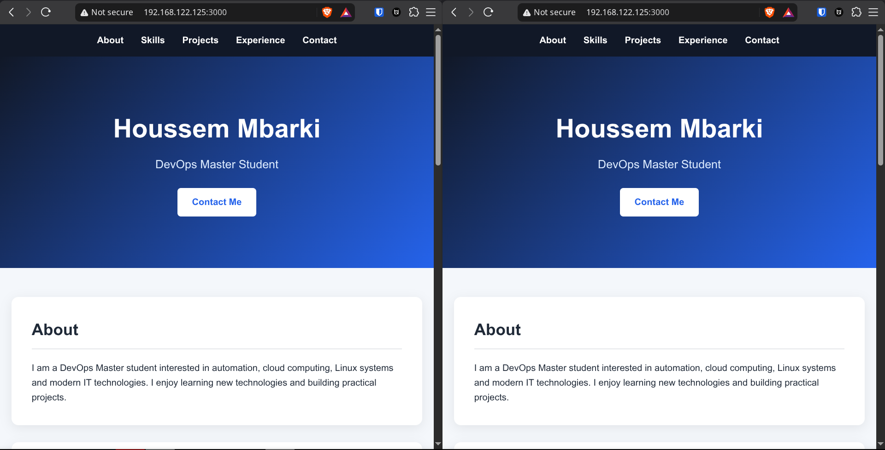

Run it a second time to verify that the deployment is repeatable, then review the result:

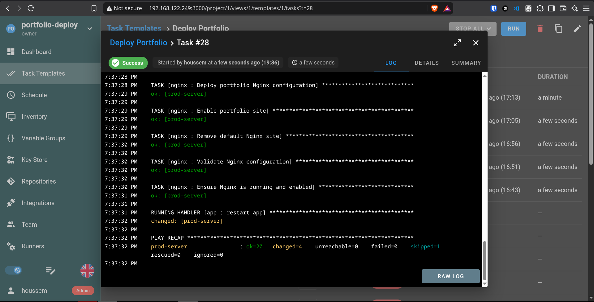

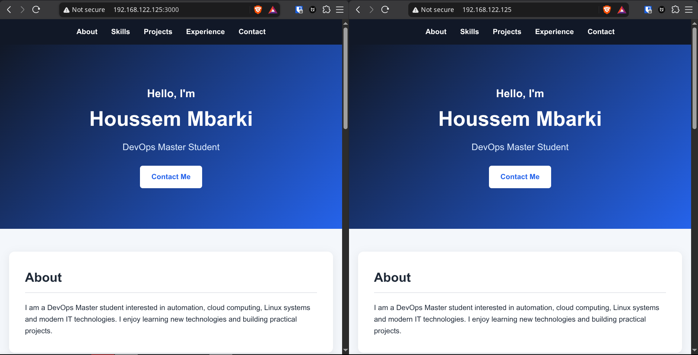

## Verification and Troubleshooting

After deployment, connect to the target server and check the services:

```bash
sudo nginx -t
sudo systemctl status nginx
sudo -u deploy pm2 describe portfolio
curl -I http://127.0.0.1:3000
curl -I http://127.0.0.1
```

If `pm2` cannot find the process, check which user started it and its `PM2_HOME` directory. PM2 maintains a separate process environment for each user; in this setup, the expected account is `deploy`.

Common issues:

- **SSH permission denied**: check `ansible_user`, the private key configured in Semaphore, and the public key in `~/.ssh/authorized_keys`.
- **Sudo / BECOME password failure**: run locally with `-K` or configure the appropriate privilege escalation method in Semaphore. Do not store passwords in plain text in the repository.
- **Semaphore error “file path must be absolute”**: enter an absolute path in the relevant field and ensure the file exists from the perspective of the Semaphore server/container.
- **Portfolio inaccessible par nom** : vérifiez `server_name`, la résolution DNS ou le fichier hosts, et l'ouverture du port 80 sur le serveur.
- **Application is not updated on every run**: the application role installs dependencies and rebuilds the project when the Git module reports a change. Check that `app_version` points to the expected commit.

## Conclusion

This project automates deployment of a Next.js portfolio on Ubuntu by separating responsibilities into Ansible roles. The first method runs and validates the playbook from the command line; Semaphore UI provides a centralized interface for configuring, launching, and auditing deployments.

**Documented branch:** [`Next-CV-deploy`](https://github.com/Sen-Se1/devsecops-portfolio/tree/Next-CV-deploy)
