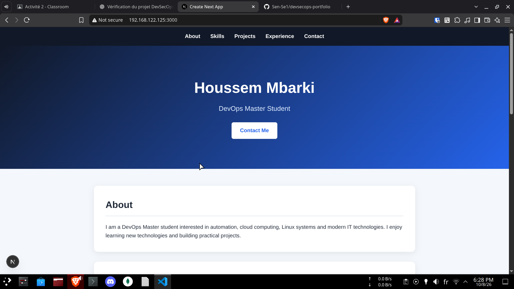
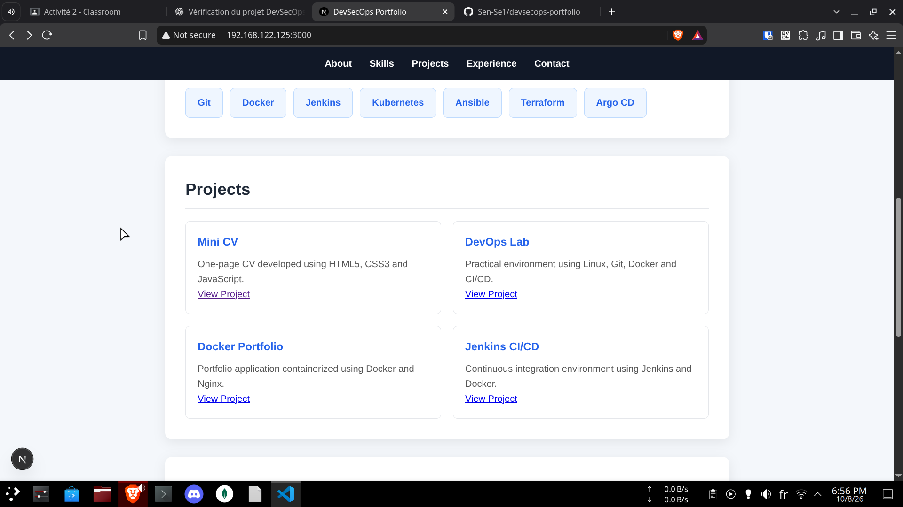
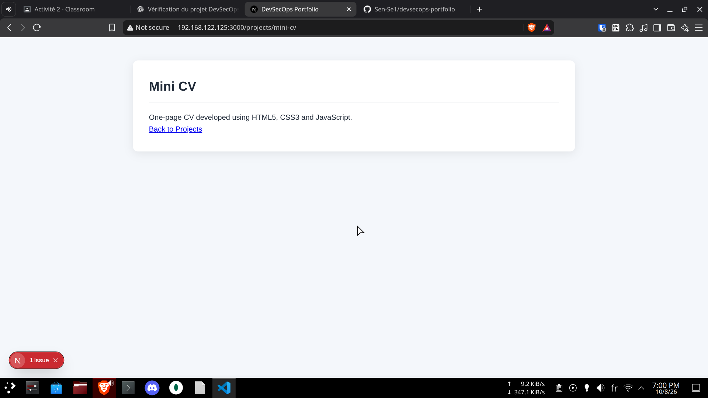
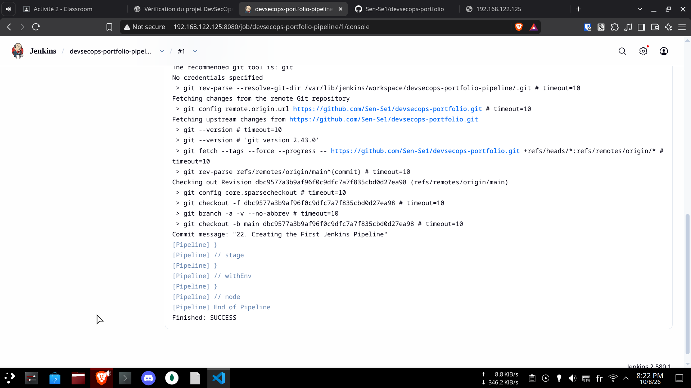
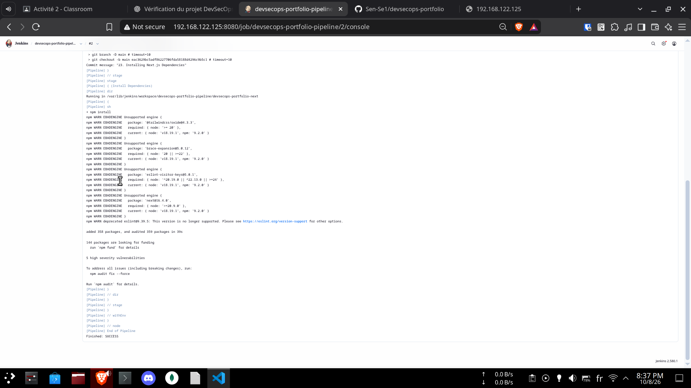
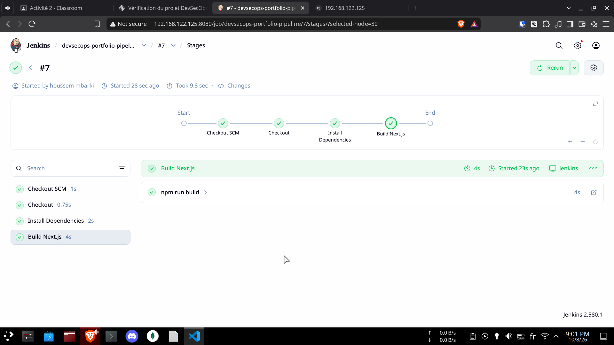

# DevSecOps Portfolio

## V. Portfolio migration to Next.js

### 18. Creating the DevSecOps Portfolio with Next.js

A new version of the **DevSecOps Portfolio** was created using **Next.js**.

The new version keeps the main sections from the HTML5/CSS3/JavaScript version:

- **About**
- **DevSecOps Skills**
- **Projects**
- **Experience**
- **Contact**
- **Footer**

The skills and projects are displayed dynamically from JavaScript arrays using the `.map()` method.

#### Creating the Next.js Project

The project was created using the following command:

```bash
npx create-next-app@latest devsecops-portfolio-next --yes
```

Then:

```bash
cd devsecops-portfolio-next
npm run dev
```

The application is accessible from the physical machine through port `3000`:

```text
http://192.168.122.125:3000
```

#### Current Structure

```text
devsecops-portfolio-next/
├── app/
│   ├── page.js
│   ├── globals.css
│   └── layout.js
├── public/
├── package.json
└── ...
```

The `page.js` file currently contains the Next.js Portfolio, while `globals.css` contains its styling.

#### Application Screenshot



---

### 19. Creating Reusable Components

The main parts of the Portfolio were transformed into reusable TypeScript components.

#### Component Structure

```text
devsecops-portfolio-next/
├── app/
│   ├── page.tsx
│   ├── globals.css
│   └── layout.tsx
├── components/
│   ├── Header.tsx
│   ├── About.tsx
│   ├── Skills.tsx
│   ├── Projects.tsx
│   ├── Contact.tsx
│   └── Footer.tsx
├── public/
└── package.json
```

The components are used in `app/page.tsx` to build the Portfolio page.

---

### 20. Separating Project and Skill Data

The project and skill information was moved into separate data files to keep the components clean and easier to maintain.

#### Data Structure

```text
devsecops-portfolio-next/
├── app/
│   ├── page.tsx
│   ├── globals.css
│   └── layout.tsx
├── components/
│   ├── Header.tsx
│   ├── About.tsx
│   ├── Skills.tsx
│   ├── Projects.tsx
│   ├── Contact.tsx
│   └── Footer.tsx
├── data/
│   ├── skills.ts
│   └── projects.ts
├── public/
└── package.json
```

#### Example of Skills Data

```ts
export const skills: string[] = [
  "Git",
  "Docker",
  "Jenkins",
  "Kubernetes",
  "Ansible",
  "Terraform",
  "Argo CD",
];
```

#### Example of Projects Data

```ts
export type Project = {
  title: string;
  description: string;
};

export const projects: Project[] = [
  {
    title: "Mini CV",
    description:
      "One-page CV developed using HTML5, CSS3 and JavaScript.",
  },
  {
    title: "DevOps Lab",
    description:
      "Practical environment using Linux, Git, Docker and CI/CD.",
  },
  {
    title: "Docker Portfolio",
    description:
      "Portfolio application containerized using Docker and Nginx.",
  },
  {
    title: "Jenkins CI/CD",
    description:
      "Continuous integration environment using Jenkins and Docker.",
  },
];
```

The `Skills.tsx` and `Projects.tsx` components import this data and use it to dynamically display the skills and projects.

---

### 21. Creating Dedicated Project Pages

A dedicated project section was added to the Next.js Portfolio.

The `/projects` page displays all available projects, while the dynamic route `/projects/project-name` displays the details of a specific project.

#### Routes

```text
/projects
/projects/mini-cv
/projects/devops-lab
/projects/docker-portfolio
/projects/jenkins-cicd
```

#### Project Page Structure

```text
app/
└── projects/
    ├── page.tsx
    └── [project-name]/
        └── page.tsx
```

The projects are loaded from the separate `data/projects.ts` file, and each project has a unique `slug` used to generate its URL.

#### Screenshot





---

## VI. Premier pipeline Jenkins

### 22. Creating the First Jenkins Pipeline

A Jenkins Pipeline was created to automatically retrieve the DevSecOps Portfolio repository from GitHub.

The Pipeline uses a `Jenkinsfile` stored at the root of the repository.

#### Jenkinsfile

```groovy
pipeline {
    agent any

    stages {
        stage('Checkout') {
            steps {
                git branch: 'main',
                    url: 'https://github.com/Sen-Se1/devsecops-portfolio.git'
            }
        }
    }
}
```

The `Checkout` stage automatically retrieves the `main` branch of the GitHub repository.

#### Jenkins Pipeline Configuration

```text
Definition: Pipeline script from SCM
SCM: Git
Repository: https://github.com/Sen-Se1/devsecops-portfolio.git
Branch: */main
Script Path: Jenkinsfile
```

#### Pipeline Execution

The Jenkins Pipeline was successfully executed. Jenkins retrieved the GitHub repository and checked out the `main` branch.



The console output confirms:

```text
[Pipeline] End of Pipeline
Finished: SUCCESS
```

This confirms that Jenkins successfully connected to the GitHub repository and executed the first pipeline.

---

### 23. Installing Next.js Dependencies

An `Install Dependencies` stage was added to the Jenkins Pipeline.

This stage enters the Next.js project directory and installs all required dependencies using `npm install`.

#### Jenkinsfile

```groovy
stage('Install Dependencies') {
    steps {
        dir('devsecops-portfolio-next') {
            sh 'npm install'
        }
    }
}
```

The `dir()` step ensures that the command is executed inside the `devsecops-portfolio-next` directory.

#### Pipeline Execution

The Pipeline was executed successfully and the `Install Dependencies` stage completed the Next.js dependency installation.



---

### 24. Building the Next.js Application

A `Build Next.js` stage was added to the Jenkins Pipeline to automatically build the Next.js application.

The stage executes `npm run build` inside the `devsecops-portfolio-next` directory.

#### Jenkinsfile

```groovy
stage('Build Next.js') {
    steps {
        dir('devsecops-portfolio-next') {
            sh 'npm run build'
        }
    }
}
```

#### Pipeline Execution

The Jenkins Pipeline was executed successfully. The `Build Next.js` stage automatically built the Next.js application.



The console output confirms that the Next.js application was compiled successfully and the pipeline finished with:

```text
Finished: SUCCESS
```
