# DevSecOps Portfolio

## VII. Automation with Ansible

### 25. Install Ansible on the Administration VM

The directory structure is located in `ansible/`:

```text
ansible/
├── ansible.cfg
├── inventory.ini
├── README.md
└── playbooks/
    ├── install-package.yml
    └── install-docker.yml
```

On the VM dedicated to administration:

```bash
sudo apt update
sudo apt install -y ansible openssh-client
ansible --version
```

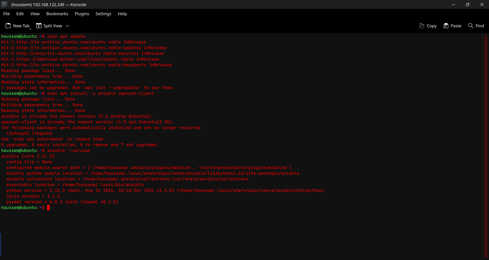

### 26. Configure the Inventory and Test SSH Communication

Edit `inventory.ini`: replace the IP address and `ansible_user` with the actual values of the target VM. SSH key-based authentication must be configured beforehand. Example to adapt:

```bash
ssh-copy-id houssem@192.168.122.125
ssh houssem@192.168.122.125
ansible all -m ping
```

Expected result if the connection is successful:

```text
ubuntu-target | SUCCESS => {
    "changed": false,
    "ping": "pong"
}
```

This result is illustrative. Capture the actual output from your terminal.

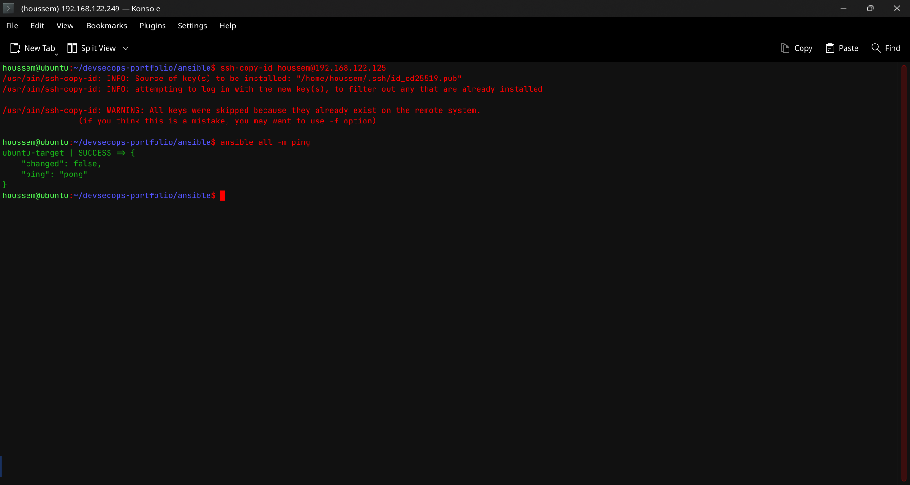

### 27. Install curl and git

From the `ansible/` directory:

```bash
ansible-playbook -i inventory.ini playbooks/install-package.yml
```

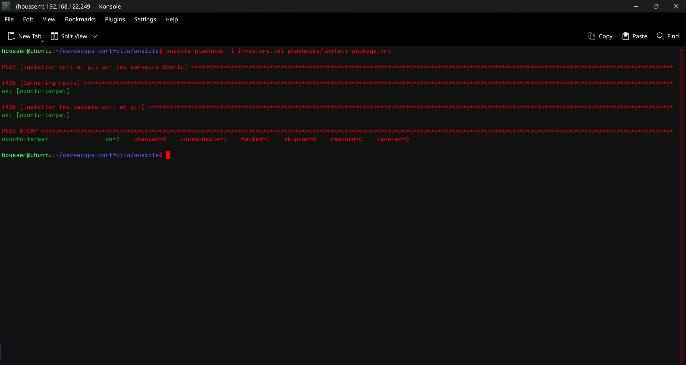

### 28. Install Docker on an Ubuntu VM

```bash
ansible-playbook -i inventory.ini playbooks/install-docker.yml
ansible -i inventory.ini portfolio_servers -m command -a "docker --version"
ansible -i inventory.ini portfolio_servers -m command -a "docker compose version"
```

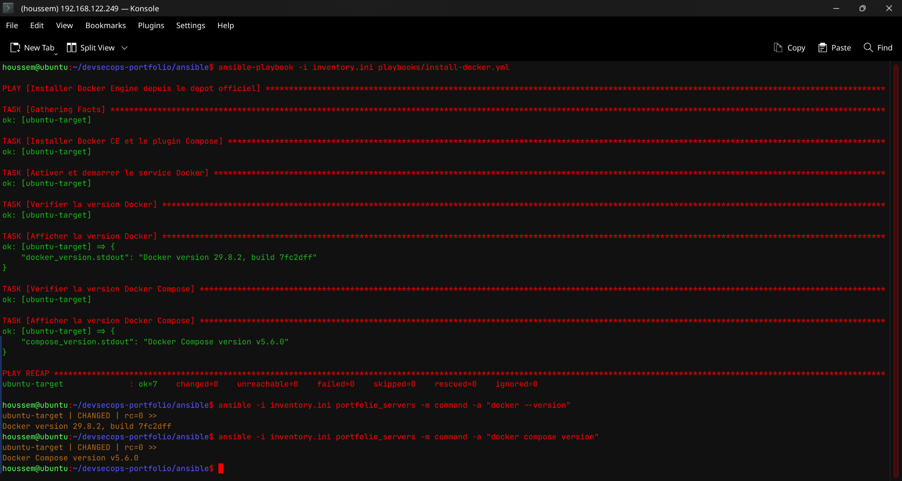

The playbook installs Docker and enables the service. Ensure that the package names in the playbook match the Docker installation method used on your target VM.

## VIII. Creating the Node.js / Express API

### 29. Create the Express API

A standalone REST API was created using Node.js and Express. It runs independently of the Next.js frontend and provides portfolio information in JSON format.

The project structure is organized as follows:

```text
devsecops-portfolio/
├── api/
│   ├── src/
│   │   └── server.js
│   ├── package.json
├── app/
├── components/
├── data/
├── .env.example
└── README.md
```

To start the API, run the following commands from the project root:

```bash
cd api
npm install
npm start
```

The Express server listens on port `4000` and can be accessed independently of the Next.js frontend.

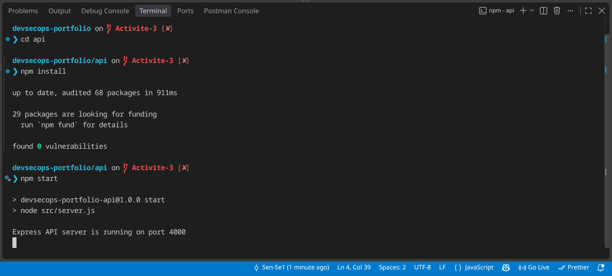

### 30. Create the Health Check Route

A health-check endpoint was added to the Express API to verify that the server is running and responding to HTTP requests.

**Endpoint:** `GET /api/health`

**Implementation:**

The route returns an HTTP `200 OK` status and a JSON response indicating that the API is operational.

**Test command:**

```bash
curl -i http://localhost:4000/api/health
```

**Expected response:**

```json
{
  "status": "ok",
  "message": "API is running"
}
```

Capture the terminal showing the `curl` command and the actual HTTP status and JSON response.

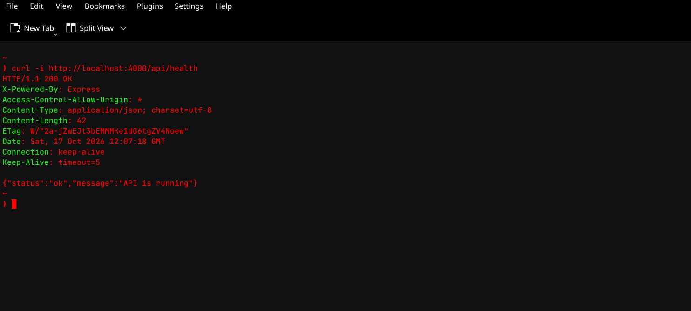

### 31. Create the Profile Route

A new endpoint, `GET /api/profile`, was added to the Express API to provide the main portfolio information in JSON format.

**Endpoint:** `GET /api/profile`

**Test command:**

```bash
curl -i http://localhost:4000/api/profile
```

**Expected result:** The API returns HTTP `200 OK` and a JSON object containing the portfolio owner's name, professional title, description, skills, projects, and GitHub profile URL.

Capture the terminal showing the request to `/api/profile` and the complete JSON response returned by the API.

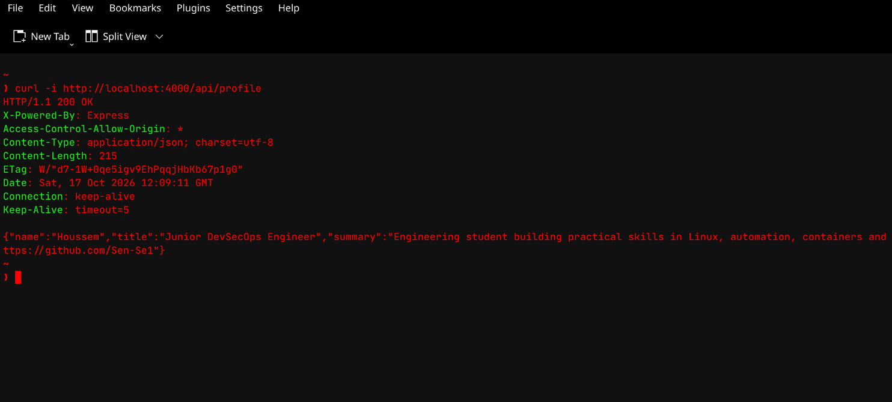

### 32. Create the Projects Route

A new endpoint, `GET /api/projects`, was added to the Express API to return the list of projects displayed in the portfolio.

**Endpoint:** `GET /api/projects`

**Test command:**

```bash
curl -i http://localhost:4000/api/projects
```

**Expected result:** The API returns HTTP `200 OK` and a JSON array containing project information, including project names, descriptions, technologies, and repository links where available.

Capture the terminal showing the request to `/api/projects` and the JSON array returned by the API.


### 33. Create the Skills Route

A new endpoint, `GET /api/skills`, was added to the Express API to return the technical skills displayed in the portfolio.

**Endpoint:** `GET /api/skills`

**Test command:**

```bash
curl -i http://localhost:4000/api/skills
```

**Expected result:** The API returns HTTP `200 OK` and a JSON array containing skill categories and their corresponding skills.

Capture the terminal showing the request to `/api/skills` and the JSON response returned by the API.


### 34. Integrate the Projects API into Next.js

The Next.js frontend was modified to retrieve project data from the Express API instead of relying exclusively on local data.

A reusable API function, `getProjects()`, was created in `lib/api.ts`. It fetches project information from the `GET /api/projects` endpoint. The `components/Projects.tsx` component uses this function to display the project list and is reused on both the homepage (`app/page.tsx`) and the dedicated projects page (`app/projects/page.tsx`).

The dynamic project detail page (`app/projects/[project-name]/page.tsx`) also retrieves project information from the same API function to display individual project details.

Capture the browser displaying the Projects section with project cards populated from the Express API. For additional evidence, include the browser's Network tab showing the successful `/api/projects` request.


**Result:** The projects are retrieved through a reusable API function, reducing duplicated code and separating the frontend presentation from the backend data source.

### 35. Integrate the Skills API into Next.js

The Next.js Skills component was modified to retrieve skills from the Express API instead of importing them directly from the local `data/skills.ts` file.

A reusable `getSkills()` function was added to `lib/api.ts`. It calls the `GET /api/skills` endpoint, and `components/Skills.tsx` renders the returned skills using the existing CSS classes.

The Skills component is wrapped in a React `Suspense` boundary to provide a loading fallback while the uncached API request is being processed.

**Test command:**

```bash
curl -i http://localhost:4000/api/skills
```

Capture the portfolio's Skills section in the browser, showing the skills returned by the Express API. For additional evidence, include the successful `/api/skills` request in the browser's Network tab.

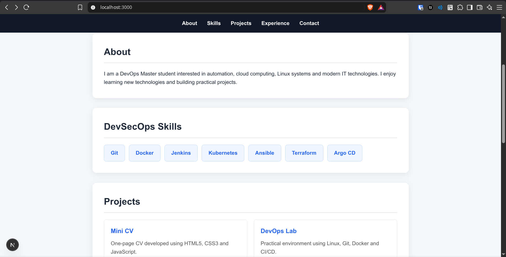

**Result:** The Skills section now retrieves its data from the Express API through a reusable function, keeping data access separate from frontend presentation.

## IX. Environment Variables and Configuration

### 36. Configure the API URL

The API URL is configured through the `API_URL` environment variable instead of being hardcoded in the Next.js components.

For local development, `.env.local` contains:

```env
API_URL=http://localhost:4000
```

The reusable API functions in `lib/api.ts` read this variable to communicate with the Express backend.

Using an environment variable makes the application easier to configure across development, testing, and production environments without modifying the source code. When Next.js runs inside Docker Compose, the API URL can be set to `http://api:4000` if the Express service is named `api`.

### 37. Create the Environment Example File

A `.env.example` file was created to document the configuration required to run the project. It contains example values and does not include real secrets or credentials.

**File: `.env.example`**

```env
API_URL=http://localhost:4000

PORT=4000
```

Developers can use this file as a reference when creating their own local environment configuration.

The `.env.example` file is committed to version control, while `.env.local` is excluded from Git to avoid committing environment-specific settings or sensitive information.

## X. Dockerizing the Frontend and API

### 38. Create the Frontend Dockerfile

A multi-stage Dockerfile was created at the project root to build and run the Next.js frontend in production mode.

The Dockerfile uses Node.js Alpine images to install dependencies, build the application, and run the optimized standalone server. The Next.js configuration includes `output: "standalone"` to generate the production output.

**File: `Dockerfile`**

```dockerfile
FROM node:22-alpine AS deps
WORKDIR /app
COPY package.json package-lock.json ./
RUN npm ci

FROM node:22-alpine AS builder
WORKDIR /app
COPY --from=deps /app/node_modules ./node_modules
COPY . .
ENV NEXT_TELEMETRY_DISABLED=1
RUN npm run build

FROM node:22-alpine AS runner
WORKDIR /app
ENV NODE_ENV=production
ENV NEXT_TELEMETRY_DISABLED=1
ENV PORT=3000
ENV HOSTNAME=0.0.0.0

RUN addgroup --system --gid 1001 nodejs \
    && adduser --system --uid 1001 nextjs

COPY --from=builder /app/public ./public
COPY --from=builder --chown=nextjs:nodejs /app/.next/standalone ./
COPY --from=builder --chown=nextjs:nodejs /app/.next/static ./.next/static

USER nextjs
EXPOSE 3000
CMD ["node", "server.js"]
```

### 39. Create the API Dockerfile

A separate Dockerfile was created in `api/Dockerfile` to containerize the Express API independently of the frontend.

It installs production dependencies, copies the API source code, and starts the server on port `4000`.

**File: `api/Dockerfile`**

```dockerfile
FROM node:22-alpine
ENV NODE_ENV=production
WORKDIR /app

COPY package.json package-lock.json ./
RUN npm ci --omit=dev

COPY --chown=node:node src ./src

USER node
ENV PORT=4000
EXPOSE 4000

CMD ["npm", "start"]
```

### 40. Build the Docker Images

Two Docker images were built separately for the frontend and the API.

**Build the frontend image:**

```bash
docker build -t devsecops-portfolio .
```

**Build the API image:**

```bash
docker build -t devsecops-api ./api
```

**List the generated images:**

```bash
docker images
```

The expected images are:

- `devsecops-portfolio` — Next.js frontend.
- `devsecops-api` — Node.js / Express backend.

**Run both containers:**

```bash
docker network create portfolio-net

docker run -d \
  --name devsecops-api \
  --network portfolio-net \
  -p 4000:4000 \
  devsecops-api:1

docker run -d \
  --name devsecops-portfolio \
  --network portfolio-net \
  -e API_URL=http://devsecops-api:4000 \
  -p 3000:3000 \
  devsecops-portfolio:1
```

The containers communicate over a shared Docker network. The frontend uses the `API_URL` environment variable to reach the Express API.

**Verification:**

```bash
docker images
docker ps
curl http://localhost:4000/api/health
curl http://localhost:4000/api/projects
```

Open `http://localhost:3000` to verify that the frontend loads and retrieves project data from the API.

**Screenshots to include:**

1. Frontend Docker image build and successful completion.

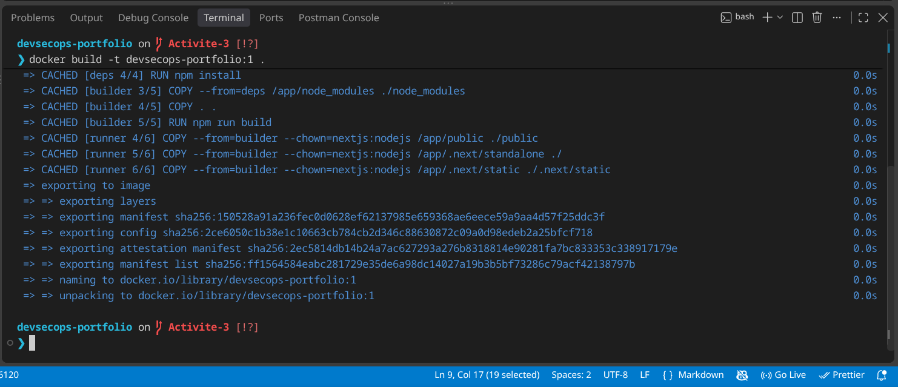

2. API Docker image build and successful completion.

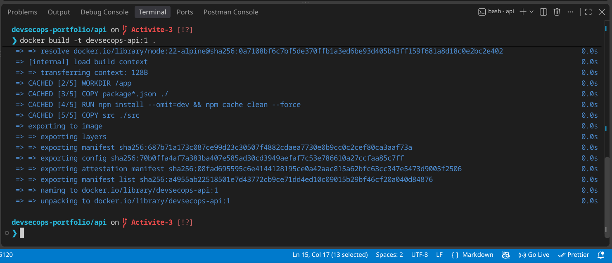

3. Output of `docker images` showing both required images.

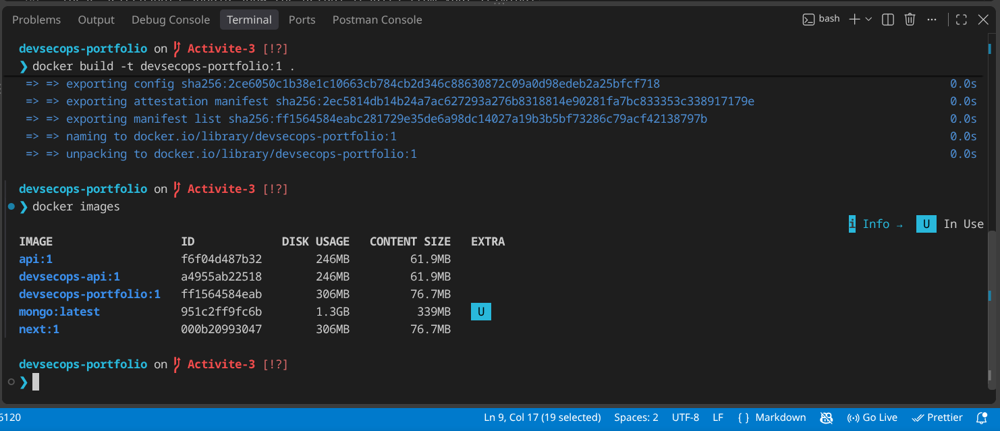

4. Output of `docker ps` showing both running containers.

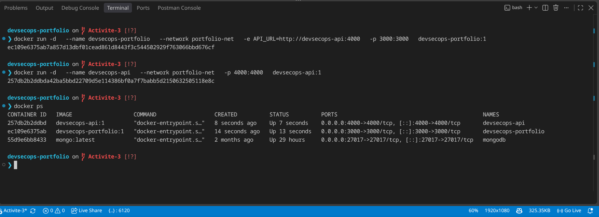

These screenshots should show the actual results from your terminal.

### Activity 41 — Docker Compose

#### Objective

Use Docker Compose to build and run the Next.js frontend and Express API together.

#### Docker Compose configuration

The `docker-compose.yml` file is located at the root of the repository. It defines two services:

- **api:** builds the Express API from `./api` and publishes port `4000`.
- **frontend:** builds the Next.js application from the project root and publishes port `3000`.

The frontend uses `API_URL=http://api:4000` to communicate with the API through the internal Docker Compose network. The `depends_on` option specifies that the API service is started before the frontend service.

#### Start the application

```bash
docker compose config
docker compose build
docker compose up -d
```

#### Verify running containers

Run the following command:

```bash
docker compose ps
```

**Expected result:** both `api` and `frontend` are running, with ports `4000` and `3000` published respectively.

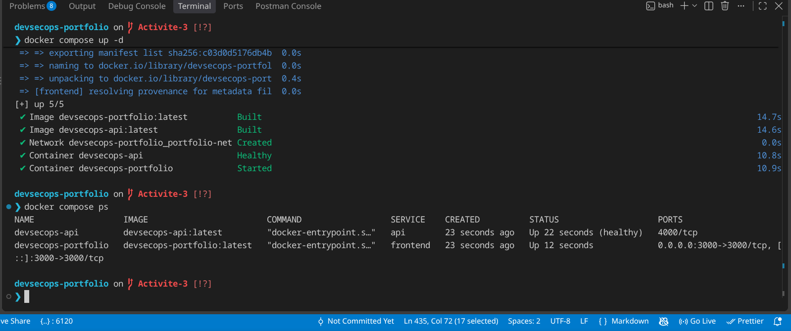

#### Stop the application

```bash
docker compose down
```

## Activity 42 — Verify Frontend–API Communication

### Objective

Verify that the Next.js frontend communicates successfully with the Express API through the Docker Compose network.

### 1. Docker Network Configuration

The frontend and API services are connected to the same Docker bridge network, `portfolio-net`.

The frontend uses the following environment variable:

```env
API_URL=http://api:4000
```

The hostname `api` corresponds to the API service name defined in `docker-compose.yml`. Docker Compose resolves this hostname internally, allowing the frontend container to access the API without using `localhost`.

### 2. Verify API Connectivity

The API health endpoint was tested from inside the frontend container:

```bash
docker exec devsecops-portfolio node -e \
"fetch('http://api:4000/api/health').then(async r => { console.log('HTTP:', r.status); console.log(await r.text()); process.exit(r.ok ? 0 : 1) }).catch(e => { console.error(e); process.exit(1) })"
```

**Expected result:** HTTP status `200` and a successful JSON response from the API.

The API endpoints can also be checked from the host:

```bash
curl http://localhost:4000/api/health
curl http://localhost:4000/api/projects
curl http://localhost:4000/api/skills
```

### 3. Portfolio Integration Screenshot

The Portfolio displays project and skill information retrieved from the Express API.

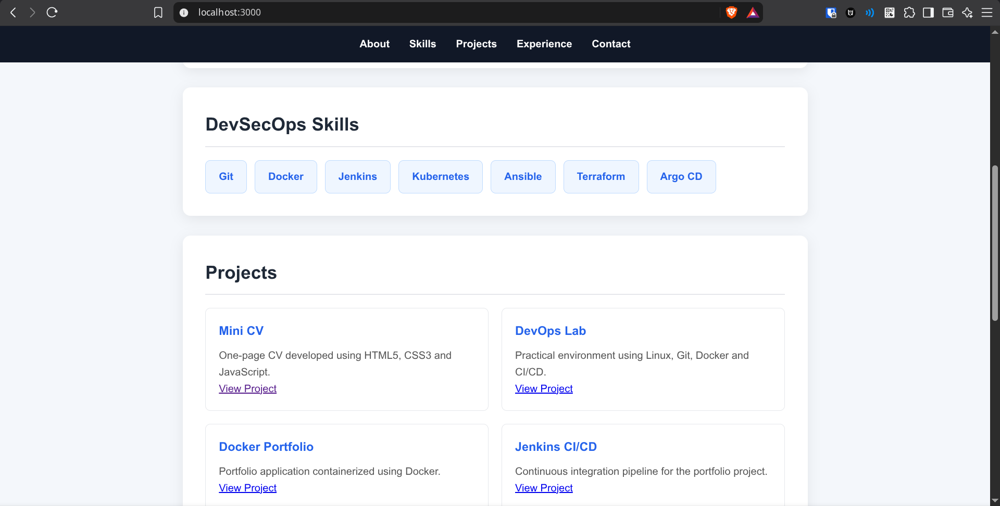

*Figure 42. Portfolio displaying data provided by the Express API.*

### Result

The frontend and API communicate through the Docker Compose bridge network. The API connectivity test confirms that the frontend container can resolve the `api` service and receive its response. The Portfolio screenshot demonstrates the API data displayed by the frontend.
